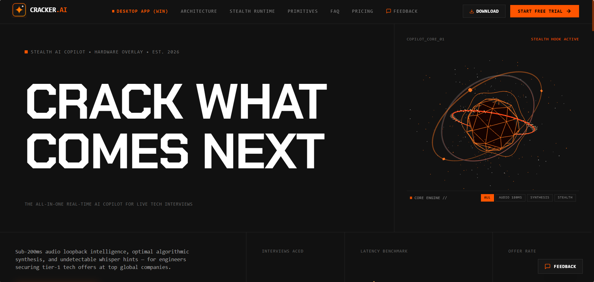
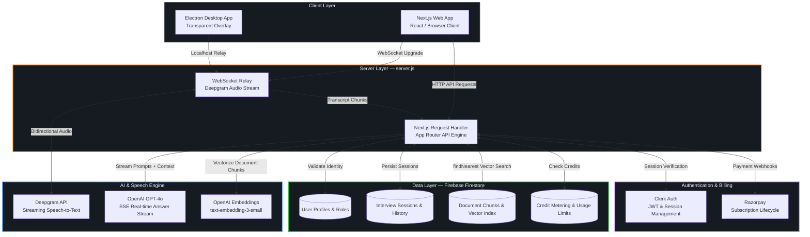

<div align="center">

# 🤖 Cracker AI

### Real-Time AI Interview Assistant

*Ace every interview with live AI coaching powered by voice, RAG, and your own documents*

[](https://nodejs.org)
[](https://nextjs.org)
[](https://www.typescriptlang.org)
[](https://firebase.google.com)
[](https://opensource.org/licenses/MIT)

<br/><br/>



</div>

---

## <div align="center">📖 Overview</div>

Cracker AI is a production-grade SaaS application designed to provide sub-second, real-time AI assistance during live technical interviews. By integrating streaming speech-to-text, context-aware large language models, and Retrieval-Augmented Generation (RAG) directly into an undetectable HUD, it surfaces authoritative technical answers tailored to the user's specific resume and verified projects.

The architecture centers around a custom Node.js WebSocket gateway that acts as a secure duplex bridge between the client and Deepgram's streaming speech recognition API. An Electron desktop client provides a transparent, frameless, hardware-accelerated overlay widget ensuring an unobtrusive user experience.

---

## <div align="center">🏗️ Architecture Overview</div>

The system is designed with a strict, unidirectional layered architecture. Communication between layers is decoupled using WebSockets and Firestore, ensuring fault-isolation, modularity, and high testability.



### <div align="center">Key Design Decisions</div>

| Decision | Rationale |
|---|---|
| **Custom `server.js` Gateway** | WebSocket protocol upgrades require raw access to the underlying `http.Server`, impossible on serverless function runtimes. |
| **Firestore Native Vector Search** | Eliminates external vector DB infrastructure (Pinecone/Weaviate) by utilizing native `findNearest` vector indices directly inside Firestore. |
| **Provider-Agnostic LLM Layer** | Abstracted AI pipeline via `providers.ts` allowing dynamic fallback between OpenAI GPT-4o and alternative inference endpoints without altering application code. |
| **Dual-Layer Authentication** | Clerk provides modern authentication flows while Firebase session tokens authenticate real-time WebSocket communication channels. |
| **Electron Native Window Overlay** | Bypasses browser extension permission sandboxes to offer system-wide frameless, click-through overlay capabilities. |

---

## <div align="center">✨ Features</div>

### <div align="center">Core Capabilities</div>

- 🎙️ **Streaming Speech-to-Text** — Persistent WebSocket relay to Deepgram with interim result streaming for ultra-low latency transcription and automatic endpointing.
- 🧠 **Context-Aware Answer Synthesis** — Server-Sent Events (SSE) streaming answers generated via GPT-4o with real-time prompt optimization.
- 📄 **RAG Document Engine** — Automated parsing for PDF (`pdf-parse`) and DOCX (`mammoth`), semantic chunking, embedding generation via `text-embedding-3-small`, and similarity search with Firestore `findNearest`.
- 🎭 **Interactive Mock Interviews** — AI-driven technical mock interview simulator with question synthesis, progressive evaluation, and session scoring.
- 🌐 **Real-Time Translation** — Real-time multi-language transcription and translation pipeline.

### <div align="center">Platform & Infrastructure</div>

- 💳 **SaaS Billing System** — Multi-tiered subscription management integrated with Razorpay, webhooks, and automatic credit replenishment.
- 🛡️ **Role-Based Admin Dashboard** — System health telemetry, token usage monitoring, user role management, and credit allocation.
- 🖥️ **Electron Desktop Client** — Hardware-accelerated, transparent, frameless window communicating with the web platform.
- 📊 **Usage Tracking & Rate Limiting** — Real-time token and credit consumption tracking with granular quotas.
- 🔐 **Secure Auth Flow** — Clerk authentication with Firebase Admin SDK verification on API routes and WebSockets.

---

## <div align="center">🛠️ Tech Stack</div>

| Layer | Technology | Version |
|---|---|---|
| **Framework** | Next.js (App Router) | 14.x |
| **Language** | TypeScript | 5.6 |
| **Styling** | Tailwind CSS + Framer Motion | 3.x / 14.x |
| **Authentication** | Clerk + Firebase Auth | 5.x |
| **Database** | Firebase Firestore (Native Vector Search) | 12.x |
| **AI / LLM** | OpenAI GPT-4o (+ Groq fallback) | openai 7.x |
| **Speech-to-Text** | Deepgram Streaming WebSocket SDK | @deepgram/sdk 5.x |
| **Embeddings** | OpenAI text-embedding-3-small | — |
| **Payments** | Razorpay SDK | 2.x |
| **Desktop Wrapper** | Electron | — |
| **WebSocket** | ws library | 8.x |
| **Validation** | Zod | 3.x |
| **Document Parsers** | pdf-parse, mammoth (DOCX) | — |

---

## <div align="center">🚀 Getting Started</div>

### <div align="center">Prerequisites</div>

| Dependency | Minimum Version | Notes |
|---|---|---|
| Node.js | >= 20.x | LTS release recommended |
| npm | >= 10.x | Bundled with Node 20 |
| Firebase Project | — | Firestore Native Mode + Auth enabled |
| OpenAI Account | — | Access to GPT-4o and Embeddings |
| Deepgram Account | — | Streaming STT enabled |
| Clerk Account | — | Authentication application configured |
| Razorpay Account | — | Test mode or production keys |

### <div align="center">1. Clone & Install</div>

```bash
git clone https://github.com/Nityanand-7484/cracker-ai.git
cd cracker-ai
npm install
```

### <div align="center">2. Configure Environment</div>

```bash
cp .env.example .env
# Configure your API credentials inside .env
```

Refer to `.env.example` for the full reference of application configuration variables.

### <div align="center">3. Firebase Setup</div>

1. Navigate to the Firebase Console and configure a new project.
2. Enable **Firestore Database** in Native Mode.
3. Enable **Authentication** providers (Email/Password and Google).
4. In **Project Settings → Service Accounts**, generate a new private key and export credentials to your `.env`.

> **Vector Search Note:** The `documents` collection relies on Firestore's native `findNearest` vector index capability (available on the Blaze plan).

### <div align="center">4. Razorpay Setup</div>

1. In the Razorpay Dashboard, generate API keys.
2. Configure plans for **Pro** and **Team** subscriptions.
3. Configure the webhook endpoint to capture `payment.captured`, `subscription.cancelled`, and `subscription.completed` events.

### <div align="center">5. Run Locally</div>

```bash
npm run dev
```

> **Note:** The application server must be launched via `node server.js` (aliased to `npm run dev`) to establish the WebSocket relay layer alongside Next.js.

---

## <div align="center">🖥️ Desktop App (Electron)</div>

The Electron client runs a lightweight frameless transparent window over your screen:

```bash
# Terminal 1 — Start web and WebSocket gateway
npm run dev

# Terminal 2 — Launch Electron client
npm run desktop
```

**Build installer package:**

```bash
npm run desktop:build
```

---

## <div align="center">🧪 Testing</div>

```bash
npm test
```

Executes test suites using the native Node.js test runner (`node:test`). Tests are structured under the `tests/` directory following the `*.test.js` pattern.

---

## <div align="center">📦 Deployment</div>

Cracker AI requires a persistent Node.js runtime to maintain persistent WebSocket streams.

### <div align="center">Recommended: Render / Railway</div>

1. Connect your repository to your cloud deployment platform.
2. **Build Command:** `npm install && npm run build`
3. **Start Command:** `npm run start`
4. Set required environment variables via the platform environment dashboard.

### <div align="center">Self-Hosted (Docker)</div>

A `docker-compose.yml` specification is provided for containerized deployments:

```bash
docker-compose up -d
```

---

## <div align="center">🔧 Troubleshooting</div>

| Issue | Resolution |
|---|---|
| **Admin Route returns 403** | Execute `POST /api/admin/init` or assign `role: "ADMIN"` in the Firestore profile document. |
| **WebSocket disconnects on connect** | Verify Deepgram API key configuration or specify `NEXT_PUBLIC_SPEECH_PROVIDER=mock` for mock audio testing. |
| **Firebase private key format error** | Ensure the private key is enclosed in quotes with literal `\n` linebreaks preserved. |
| **Module resolution errors in server.js** | Ensure `firebase-admin` 12+ is installed using standard modular imports. |

---

## <div align="center">🤝 Contributing</div>

1. Fork the repository.
2. Create your feature branch (`git checkout -b feat/my-feature`).
3. Commit your changes (`git commit -m "feat: implement feature"`).
4. Push to the branch and open a Pull Request.

---

## <div align="center">📄 License</div>

Distributed under the **MIT License**.

---

<div align="center">
Built with ❤️ by <a href="https://github.com/Nityanand-7484">Nityanand Kumar</a>
</div>