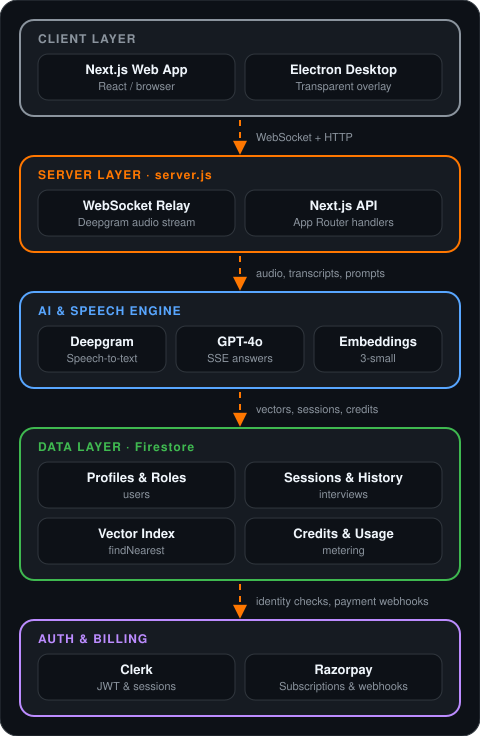

<div align="center">


<a href="https://github.com/Nityanand-7484/cracker-ai">
  
</a>

<br/>

[](https://nodejs.org)
[](https://nextjs.org)
[](https://www.typescriptlang.org)
[](https://firebase.google.com)
[](https://www.electronjs.org)
[](https://opensource.org/licenses/MIT)

<br/>


<br/>

[Overview](#-overview) · [How It Works](#-how-it-works) · [Architecture](#-architecture) · [Features](#-features)
<br/>
[Tech Stack](#-tech-stack) · [Getting Started](#-getting-started) · [Desktop App](#-desktop-app-electron) · [Deploy](#-deployment)

</div>

---

## 📖 Overview

**Cracker AI** is a production-grade SaaS app that gives you sub-second, real-time AI help during live technical interviews.

It puts three things in one flow:

- 🎙️ **Streaming speech-to-text** to hear the question as it's asked
- 🧠 **Context-aware LLM answers** streamed token by token
- 📄 **RAG** so answers are based on *your* resume and *your* verified projects

Answers show up in a transparent HUD overlay, so you never leave your interview window.

Under the hood, a custom **Node.js WebSocket gateway** is a secure two-way bridge between the client and Deepgram's streaming speech API. An **Electron** desktop client wraps it all in a frameless, hardware-accelerated overlay.

---

## 🔄 How It Works

<div align="center">
  
</div>

---

## 🏗️ Architecture

The system is a strict, layered design. Layers talk through WebSockets and Firestore, so failures stay isolated, code stays modular, and everything is easy to test.

<div align="center">
  
</div>

### 🧭 Key Design Decisions

- **Custom `server.js` gateway.** WebSocket upgrades need raw access to the underlying `http.Server`, which serverless runtimes don't allow.
- **Firestore native vector search.** No separate vector DB (Pinecone / Weaviate) to run. Firestore's `findNearest` does the job.
- **Provider-agnostic LLM layer.** `providers.ts` lets you fall back between OpenAI GPT-4o and other inference endpoints without touching app code.
- **Dual-layer authentication.** Clerk handles sign-in flows, while Firebase session tokens secure the real-time WebSocket channel.
- **Electron native overlay.** A system-wide, frameless, click-through overlay that a browser extension sandbox can't give you.

---

## ✨ Features

### Core

- 🎙️ **Streaming Speech-to-Text.** Persistent WebSocket relay to Deepgram with interim results and automatic endpointing.
- 🧠 **Context-Aware Answers.** GPT-4o answers over Server-Sent Events (SSE), with real-time prompt optimization.
- 📄 **RAG Document Engine.** Parses PDF (`pdf-parse`) and DOCX (`mammoth`), chunks semantically, embeds with `text-embedding-3-small`, and searches with Firestore `findNearest`.
- 🎭 **Mock Interviews.** AI-driven technical mock interviews with question generation, progressive evaluation, and session scoring.
- 🌐 **Real-Time Translation.** Multi-language transcription and translation pipeline.

### Platform

- 💳 **SaaS Billing.** Multi-tier subscriptions with Razorpay, webhooks, and automatic credit top-ups.
- 🛡️ **Admin Dashboard.** Role-based access, system health, token usage monitoring, user roles, and credit allocation.
- 🖥️ **Electron Desktop Client.** Hardware-accelerated, transparent, frameless window that talks to the web platform.
- 📊 **Usage Tracking & Rate Limits.** Real-time token and credit tracking with granular quotas.
- 🔐 **Secure Auth Flow.** Clerk authentication, verified with the Firebase Admin SDK on API routes and WebSockets.

---

## 🛠️ Tech Stack

<div align="center">
  
</div>

<br/>

| Layer | Technology |
|---|---|
| **Framework** | Next.js 14 (App Router) |
| **Language** | TypeScript 5.6 |
| **Styling** | Tailwind CSS 3 + Framer Motion 14 |
| **Auth** | Clerk + Firebase Auth 5 |
| **Database** | Firestore 12 (native vector search) |
| **AI / LLM** | OpenAI GPT-4o (+ Groq fallback), openai 7 |
| **Speech-to-Text** | Deepgram streaming, @deepgram/sdk 5 |
| **Embeddings** | OpenAI `text-embedding-3-small` |
| **Payments** | Razorpay SDK 2 |
| **Desktop** | Electron |
| **WebSocket** | `ws` 8 |
| **Validation** | Zod 3 |
| **Doc Parsers** | `pdf-parse`, `mammoth` |

---

## 🚀 Getting Started

### Prerequisites

- **Node.js** 20+ (LTS recommended) and **npm** 10+
- **Firebase project** with Firestore (Native Mode) and Auth enabled
- **OpenAI** account with GPT-4o and Embeddings access
- **Deepgram** account with streaming STT enabled
- **Clerk** account with an auth app configured
- **Razorpay** account (test or production keys)

### 1️⃣ Clone & Install

```bash
git clone https://github.com/Nityanand-7484/cracker-ai.git
cd cracker-ai
npm install
```

### 2️⃣ Configure Environment

```bash
cp .env.example .env
# Fill in your API credentials inside .env
```

See `.env.example` for the full list of variables.

<details>
<summary><b>3️⃣ Firebase Setup</b></summary>

<br/>

1. Create a new project in the Firebase Console.
2. Enable **Firestore Database** in Native Mode.
3. Enable **Authentication** providers (Email/Password and Google).
4. Go to **Project Settings → Service Accounts**, generate a new private key, and add the credentials to your `.env`.

> [!NOTE]
> The `documents` collection uses Firestore's native `findNearest` vector index, which needs the **Blaze plan**.

</details>

<details>
<summary><b>4️⃣ Razorpay Setup</b></summary>

<br/>

1. In the Razorpay Dashboard, generate your API keys.
2. Create plans for **Pro** and **Team** subscriptions.
3. Point the webhook endpoint at your server and enable these events:
   - `payment.captured`
   - `subscription.cancelled`
   - `subscription.completed`

</details>

### 5️⃣ Run Locally

```bash
npm run dev
```

> [!IMPORTANT]
> The app must be started with `node server.js` (already aliased to `npm run dev`). This starts the WebSocket relay next to Next.js.

---

## 🖥️ Desktop App (Electron)

The Electron client opens a lightweight, frameless, transparent window over your screen.

```bash
# Terminal 1: web app + WebSocket gateway
npm run dev

# Terminal 2: Electron client
npm run desktop
```

Build an installer:

```bash
npm run desktop:build
```

---

## 🧪 Testing

```bash
npm test
```

Tests run on the native Node.js test runner (`node:test`) and live in `tests/` using the `*.test.js` pattern.

---

## 📦 Deployment

Cracker AI needs a **persistent Node.js runtime** to keep its WebSocket streams alive, so serverless platforms won't work.

### ☁️ Render / Railway (recommended)

1. Connect your repository to the platform.
2. **Build command:** `npm install && npm run build`
3. **Start command:** `npm run start`
4. Add all required environment variables in the dashboard.

### 🐳 Self-hosted (Docker)

```bash
docker-compose up -d
```

---

## 🔧 Troubleshooting

<details>
<summary><b>Admin route returns 403</b></summary>

<br/>

Run `POST /api/admin/init`, or set `role: "ADMIN"` on your profile document in Firestore.

</details>

<details>
<summary><b>WebSocket disconnects right after connecting</b></summary>

<br/>

Check your Deepgram API key. To test without real audio, set `NEXT_PUBLIC_SPEECH_PROVIDER=mock`.

</details>

<details>
<summary><b>Firebase private key format error</b></summary>

<br/>

Wrap the private key in quotes and keep the literal `\n` line breaks.

</details>

<details>
<summary><b>Module resolution errors in server.js</b></summary>

<br/>

Make sure `firebase-admin` 12+ is installed and you're using the standard modular imports.

</details>

---

## 🤝 Contributing

1. Fork the repository.
2. Create a feature branch: `git checkout -b feat/my-feature`
3. Commit your changes: `git commit -m "feat: implement feature"`
4. Push the branch and open a Pull Request.

---

## 📄 License

Distributed under the **MIT License**.

<div align="center">

<br/>

**Built with ❤️ by [Nityanand Kumar](https://github.com/Nityanand-7484)**


</div>
